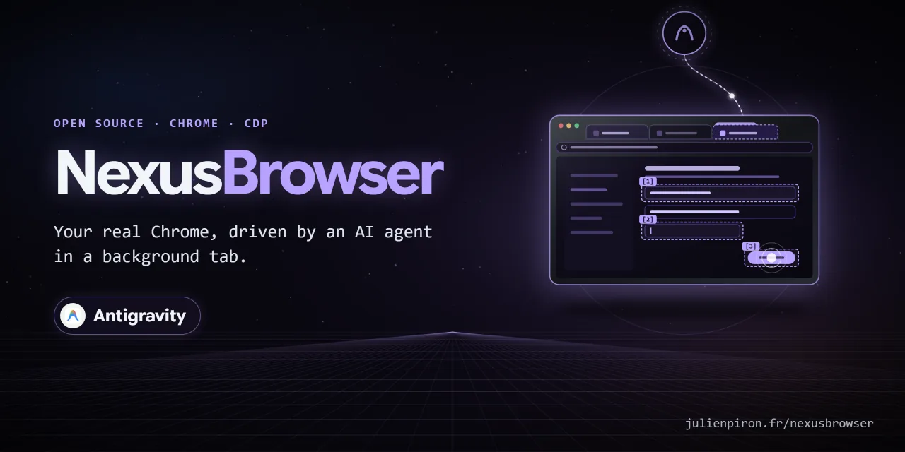

# NexusBrowser

[](https://github.com/pironjulien/chrome-computer-use/releases)
[](LICENSE)
[](extension/manifest.json)
[](pyproject.toml)
[](https://modelcontextprotocol.io)

[](https://julienpiron.fr/nexusbrowser/)

**Your real Chrome, driven by AI agents in background tabs.** NexusBrowser lets Antigravity, Claude and Codex use
the user's own Chrome (their sessions, their extensions) through one shared local bridge and one MCP server,
`nexus-browser`. Each agent works in its own background tabs, grouped under its name, with real (trusted) mouse
and keyboard events sent through the Chrome DevTools Protocol, while the user keeps working in their own tabs.

Version 2.8.1 · Windows 10/11 · Chrome 116+ · Python 3.14 · MIT licence

Part of the Nexus family: [NexusWindows](https://julienpiron.fr/nexuswindows/)
([Claude](https://github.com/pironjulien/claude-windows-computer-use) ·
[Codex](https://github.com/pironjulien/codex-windows-computer-use) ·
[Antigravity](https://github.com/pironjulien/antigravity-windows-computer-use)),
[NexusBrowser](https://julienpiron.fr/nexusbrowser/) ([repo](https://github.com/pironjulien/chrome-computer-use)),
[NexusAndroid](https://julienpiron.fr/nexusandroid/) ([repo](https://github.com/pironjulien/android-computer-use)).
Project page: [julienpiron.fr/nexusbrowser](https://julienpiron.fr/nexusbrowser/).

## Why

Browser automation usually means a separate headless browser (no sessions, no extensions) or screen-level computer
use that moves the user's cursor and brings the window to the front. NexusBrowser works inside the browser the user
already uses, without activating the agent's tab or window, and keeps the guard rails in the extension and the
bridge rather than in the agent: tab ownership, an allowlist of DevTools commands, masked secrets, an emergency stop.

- **Antigravity**: its own browser agent runs in a separate Chrome profile, without the cookies or sign-ins of the
  user's browsing ([Antigravity docs](https://antigravity.google/docs/ide/separate-chrome-profile/)). NexusBrowser
  gives it the user's real Chrome.
- **Claude and Codex** already have their own Chrome extension (Claude in Chrome, the Codex Chrome extension).
  NexusBrowser complements it where a bridge with the DevTools protocol helps: JavaScript dialogs
  (`browser_handle_dialog`), detailed network capture with response bodies, elements inside cross-origin iframes,
  content and Google Docs/Sheets/Slides exports, and downloads.

Until 2.4.0 it was published here as "Antigravity Browser Bridge", for Antigravity only. Since 2.6.0 it is a neutral
bridge shared by several agents.

## Pieces

| Folder | Role |
| --- | --- |
| `extension/` | Chrome MV3 extension "Nexus Browser Bridge": CDP actions, locators, network, dialogs, cross-origin iframes, exports, tab ownership, control panel |
| `native-host/` | Local bridge (`bridge_server.py`: WebSocket 9224 for the extension, HTTP 9225 for the agents) and native host `com.nexus.browser_auth` |
| `client/` | MCP server `nexus-browser` (`mcp_server.py`), authenticated transport (`bridge_client.py`), CLI (`browser_cli.py`), shared emergency stop |
| `skills/`, `plugins/` | Skill (copied for Antigravity, Claude Code and Codex) and Antigravity plugin, by `install.ps1` |

## Tools

47 MCP tools. Tool descriptions and messages are in French; tool and parameter names are in English.

| Area | Tools |
| --- | --- |
| Tabs | `browser_list_tabs`, `browser_active_tab` (read only), `browser_new_tab`, `browser_select_tab`, `browser_adopt_tab`, `browser_release_tab`, `browser_group_tabs`, `browser_close_tab`, `browser_reload`, `browser_navigate`, `browser_wait_load` |
| Input (trusted CDP events) | `browser_click`, `browser_semantic_click`, `browser_hover`, `browser_fill`, `browser_semantic_fill`, `browser_select_option`, `browser_check`, `browser_press_key`, `browser_type_keys`, `browser_drag_and_drop`, `browser_scroll`, `browser_upload`, `browser_handle_dialog` |
| Finding elements | `browser_find` (Playwright-style locators: role, label, text, placeholder, test id, in every frame), `browser_interactive_map`, `browser_vision_inspect` and `browser_click_mark` (Set-of-Mark badges), `browser_axtree`, `browser_content`, `browser_check_handoff` (2FA, CAPTCHA) |
| Network and downloads | `browser_network_record`, `browser_network_stop`, `browser_network_requests`, `browser_network_response`, `browser_wait_network_idle`, `browser_download_status`, `browser_wait_download`, `browser_get_cookies` |
| Output | `browser_screenshot`, `browser_pdf`, `browser_export` (main content as Markdown, text or HTML), `browser_export_gsuite` (Google Docs, Sheets, Slides through Google's export URLs), `browser_export_youtube_transcript`, `browser_logs` |
| Page access | `browser_eval`, `browser_cdp_send` (allowlisted commands) |

## Install

Requirements: Windows 10 or 11, Chrome, [uv](https://docs.astral.sh/uv/), Python 3.14.

```powershell
git clone https://github.com/pironjulien/chrome-computer-use.git
cd chrome-computer-use
pwsh -NoProfile -File install.ps1
```

- Python environment, token, logs, screenshots and exports live in `~\.nexus\nexus-browser` (outside the clone).
- Scheduled task `Nexus Browser Bridge` with **no trigger**: the bridge starts on demand (first agent call,
  `schtasks /Run`).
- Native host `com.nexus.browser_auth` declared to Chrome (HKCU): it computes the extension's proofs, the token never
  reaches Chrome.
- MCP server `nexus-browser` registered for Claude Code, Codex and Antigravity when they are installed, each with
  `NEXUS_BROWSER_AGENT` set to its name (default tab group).
- When the bridge has to relaunch Chrome, it uses the `Default` profile; extra Chrome flags (language...)
  can be added with the `NEXUS_CHROME_EXTRA_ARGS` environment variable (flags only, code-loading flags ignored).
- Migration from the former "Antigravity Browser Bridge": its task (same ports) and native host
  `com.nexusagy.bridge_auth` are removed.

Then load `extension\` once in `chrome://extensions` (developer mode, "Load unpacked") and remove the old
"Antigravity Browser Bridge" if present. The extension ID is fixed by the public `key` in `manifest.json`
(`blcgddmjdkobmgakjffjpgiicjlflgjf`), the same on every PC and whatever the folder; it is the only origin the bridge
and the native host accept.

## Security (held by the extension and the bridge, not by the agent)

- **Mutually authenticated bridge** (`nexus-browser/1`): HMAC proofs over both nonces, then every message signed
  with a per-connection key and a strict sequence number. HTTP requires `X-Nexus-Browser-Token` and refuses any
  browser origin.
- **Tab ownership**: every bridge client identifies itself (agent + session headers, forwarded by the bridge in the
  signed channel). A tab opened by `browser_new_tab` belongs to that session (`chrome.storage.session`); any page
  command on another tab (the user's, another agent's) is refused. A tab of the user only through
  `browser_adopt_tab(tab_id, julien_asked=True)` (the parameter keeps its historical name). `tab_id` is mandatory on
  every page tool. A session whose MCP process is gone (or silent for 1.618 x 60 s; servers beat every 37 s) leaves
  **orphan** tabs: the same agent can reclaim (`browser_adopt_tab`, also automatically at startup), close or release
  them; never another agent.
- **CDP allowlist** for `browser_cdp_send`; every extension script runs in an **isolated world** (only
  `browser_eval`, the YouTube transcript and `browser_cdp_send(..., world="page")` touch the page's world).
- **Secrets**: secret headers, URL parameters and JSON/form body fields masked (pagination tokens and LLM token
  counters kept); cookie values only for local development origins (`include_values=True`); uploads refused by the
  bridge itself from secret folders (normalized paths). The value of a password, one-time code or payment card field
  (`type=password`, `autocomplete` current-password, new-password, one-time-code, cc-number, cc-csc, cc-exp) never
  leaves the page: `browser_content` (html mode included), `browser_vision_inspect`, `browser_find`,
  `browser_axtree` and the value read back by `browser_fill` return `[valeur masquée]` instead.
- **`browser_eval` is full access to the page, nothing masked**: like `browser_cdp_send(Runtime.evaluate)` (both
  worlds share the document), it reads what the page reads (non-HttpOnly cookies through `document.cookie`,
  localStorage, sessionStorage, IndexedDB, form fields) and its `fetch` carries the user's session. The masking
  above covers the dedicated tools, not scripts nor the raw Chrome replies of `browser_cdp_send`
  (`DOM.getOuterHTML`, `Accessibility.getFullAXTree`...): kept on purpose, said plainly in the tool, the skill and
  the server instructions. `Page.reload` with `scriptToEvaluateOnLoad` is refused (script injected at load).
- **Emergency stop** (Ctrl+Alt+Shift+Esc, STOP button of the control panel, `~\.nexus\stop`): commands already
  running are cancelled (typing, drag, waits), debuggers detached, every action refused for 120 s. The same file
  protocol is shared with the [NexusWindows](https://julienpiron.fr/nexuswindows/) agents.
- **Control panel** (side panel, Alt+Shift+N): tabs driven by each agent, debugger state, STOP, give a tab back.
- Whoever holds the bridge token controls the browser session: keep `~\.nexus\nexus-browser\bridge-token` private.

## Checks

```powershell
pwsh -NoProfile -File test.ps1         # offline: ruff, Pyright, pytest (real bridge on ephemeral ports), Node tests
pwsh -NoProfile -File test.ps1 -Full   # plus real validation in the user's Chrome: --mouse then --full-live
pwsh -NoProfile -File verify.ps1 -Browser  # task, native host, bridge reached, loaded extension up to date
```

`test.ps1` uses the environment created by `install.ps1`.

## Limits

- Windows and Chrome only (Manifest V3, `chrome.debugger`). While the debugger is attached, Chrome shows its "is
  being debugged" banner on the agent tab. Protected pages (`chrome://`, the Web Store) cannot be scripted.
- Tab ownership is per MCP process: sub-agents of one conversation share it.
- The YouTube transcript reads the page's own player (page world).
- Tool descriptions, messages and code comments are in French.

## Licence

MIT, see [LICENSE](LICENSE). Copyright (c) 2026 Julien Piron.
