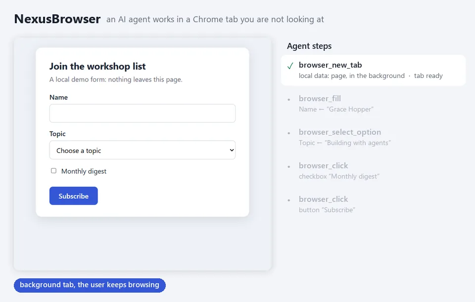
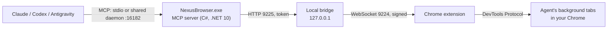

<div align="center">

<a href="https://julienpiron.fr/nexusbrowser/"></a>

# NexusBrowser

**Your real Chrome, driven by AI agents in background tabs.**

Antigravity, Claude and Codex use your own Chrome, with your sessions and extensions, each in its own background
tabs, while you keep browsing in yours.

[](https://github.com/pironjulien/NexusBrowser/actions/workflows/tests.yml)
[](https://scorecard.dev/viewer/?uri=github.com/pironjulien/NexusBrowser)
[](https://www.bestpractices.dev/projects/16434)
[](https://github.com/pironjulien/NexusBrowser/releases/latest)
[](#-quick-start)
[](extension/manifest.json)
[](native/NexusBrowser.csproj)
[](https://modelcontextprotocol.io)
[](LICENSE)

[](https://apps.microsoft.com/detail/9NSH2P3QLWT1)

[🌐 Website](https://julienpiron.fr/nexusbrowser/) · [📦 Get it with NexusSystem](https://github.com/pironjulien/NexusSystem) · [▶️ Watch the video](https://media.julienpiron.fr/videos/nexusbrowser.h264.mp4) · [📝 Changelog](CHANGELOG.md)

</div>

<div align="center">
<a href="https://media.julienpiron.fr/videos/nexusbrowser.h264.mp4"></a>
<br><sub>▶ Click to watch the video · <a href="https://julienpiron.fr/nexusbrowser/">more on julienpiron.fr</a></sub>
</div>

## ✨ Why NexusBrowser

<table>
<tr>
<td width="33%">🌐 <b>Your real Chrome</b><br>Your sessions and extensions, not a separate headless browser or an empty profile.</td>
<td width="33%">🗂️ <b>Background tabs, per agent</b><br>Each agent works in its own tabs, grouped under its name, without activating them or taking your cursor.</td>
<td width="33%">🖱️ <b>Trusted input</b><br>Real mouse and keyboard events through the Chrome DevTools Protocol, with Playwright-style locators in every frame.</td>
</tr>
<tr>
<td>🧰 <b>49 MCP tools</b><br>Dialogs, network with response bodies, cross-origin iframes, exports (page, Google Docs/Sheets/Slides, YouTube transcript), downloads, WebMCP.</td>
<td>🛡️ <b>Guard rails in the bridge</b><br>Tab ownership, a DevTools allowlist, masked secrets, and your yes for every outward action (send, pay, publish).</td>
<td>🛑 <b>Emergency stop</b><br>One file (or Ctrl+Alt+Shift+Esc with NexusWindows) cancels running commands and refuses every action for 120 s.</td>
</tr>
</table>

Windows 10/11 (x64 and ARM64) · Chrome 116+ · self-contained .NET engine, nothing else to install · MIT licence

### See it in action



<details>
<summary><b>Why a bridge, next to each agent's own browser tools</b></summary>

Browser automation usually means a separate headless browser (no sessions, no extensions) or screen-level computer
use that moves the user's cursor and brings the window to the front. NexusBrowser works inside the browser the user
already uses, without activating the agent's tab or window, and keeps the guard rails in the extension and the
bridge rather than in the agent: tab ownership, an allowlist of DevTools commands, masked secrets, an emergency stop.

- **Antigravity**: its own browser agent runs in a separate Chrome profile, without the cookies or sign-ins of the
  user's browsing ([Antigravity docs](https://antigravity.google/docs/ide/separate-chrome-profile/)). NexusBrowser
  gives it the user's real Chrome.
- **Claude and Codex** already have their own Chrome extension (Claude in Chrome, the Codex Chrome extension).
  NexusBrowser complements it where a bridge with the DevTools protocol helps: JavaScript dialogs
  (`browser_handle_dialog`), detailed network capture with response bodies, elements inside cross-origin iframes,
  content and Google Docs/Sheets/Slides exports, and downloads.

Until 2.4.0 it was published here as "Antigravity Browser Bridge", for Antigravity only. Since 2.6.0 it is a neutral
bridge shared by several agents.

</details>

## 🚀 Quick start

Windows 10 or 11 and Google Chrome. No admin rights, nothing else to install first.

> [!TIP]
> **Let your AI install it.** Paste this sentence into **Claude Code**, **Codex** or **Antigravity**:
>
> ```text
> Install and set up NexusBrowser for me by following https://raw.githubusercontent.com/pironjulien/NexusSystem/main/INSTALL-AI.md
> ```

**Or the NexusSystem app** from the [Microsoft Store](https://apps.microsoft.com/detail/9NSH2P3QLWT1)
(`winget install --id 9NSH2P3QLWT1 --source msstore`): it installs NexusBrowser for you. New versions are no longer
published to PyPI; earlier packages stay available.

> [!IMPORTANT]
> **One manual step: load the extension.** Chrome opens `chrome://extensions` and the extension folder is copied to
> the clipboard: turn on **Developer mode** (top right), click **Load unpacked**, paste the folder (`Ctrl+V`) and click
> **Select Folder**. Outside the Chrome Web Store, Chrome installs an extension this way only. The installer waits and
> says when the extension is connected.

Then restart your AI app and ask it, for example: *"Open https://example.com in a background tab and give me the page
as Markdown."*

<details>
<summary><b>Manual install (verified)</b></summary>

Download the installer and the checksums of the latest release, check the installer, then run it as a file (never
paste a downloaded script into PowerShell):

```powershell
$r = 'https://github.com/pironjulien/NexusBrowser/releases/latest/download'
Invoke-WebRequest "$r/get.ps1" -OutFile get.ps1
Invoke-WebRequest "$r/SHA256SUMS.txt" -OutFile SHA256SUMS.txt
(Get-FileHash get.ps1 -Algorithm SHA256).Hash   # must match the get.ps1 line of SHA256SUMS.txt
gh attestation verify get.ps1 --repo pironjulien/NexusBrowser --signer-repo pironjulien/NexusSystem   # optional: build provenance
powershell -NoProfile -ExecutionPolicy Bypass -File .\get.ps1
```

It downloads the latest release for your PC (x64 or ARM64), checks it against `SHA256SUMS.txt` (and its build
provenance when the GitHub CLI is signed in), then starts the release's own engine (`NexusBrowser.exe --install`),
which unpacks it into `%LOCALAPPDATA%\NexusBrowser\app`, sets up the local bridge, the native host and the shared MCP daemon
(`127.0.0.1:16182`, shared token file `NEXUS_MCP_TOKEN_FILE`, otherwise `~\.nexus\mcp-token.txt`, mirrored in your
user variable `NEXUS_MCP_TOKEN`), and declares the `nexus-browser` server to every AI client it finds: **Claude
Code**, **Claude Desktop**, **Codex** and **Antigravity**. No Python, no .NET to install: the engine is
self-contained. Then load the extension as described above.

</details>

<details>
<summary><b>Updates and automatic maintenance</b></summary>

Run the installer again to update: the folder stays the same, so Chrome keeps the extension and reloads it. The new
version is prepared beside the working one and checked first; a failed update restores the previous version. Chrome
and the AI apps keep running. A bridge with running calls or agent-owned tabs keeps serving; the installer asks an
idle bridge to exit cooperatively and never terminates it. Bridges older than 2.33.2 switch on their next natural
start because they do not implement this protocol. The daemon has a separate session-preserving restart protocol from
2.33.3: older or unrecognized daemons keep serving until natural exit, and the installer writes no restart request for
them.

The bridge can also update a public install itself (the contract shared by the Nexus products): it writes
`~\.nexus\status\browser.json` (`version`, `latest` read from the `releases/latest` redirect at most once a day,
`state`, `message`), `GET /api/update` returns it and `POST /api/update` (bridge token) starts the "NexusBrowser
Update" task, which runs the installed engine (`NexusBrowser.exe --self-update`: NexusSystem's maintenance when it is
installed, else the latest release, checked, installed by its own engine) outside the bridge (the current version is kept;
deferred while an agent works in Chrome). A clone updates with git instead.

Automatic maintenance is owned by NexusSystem (`get-nexus.ps1 -Maintain`), not by a second product timer. It calls
`get.ps1 -UpdateOnly` on an already installed release: no new AI app is configured and disabled or custom routes stay
untouched. Published, installed and loaded versions are distinct; a deferred activation is retried by NexusSystem.
`NEXUS_UPDATE_RESULT` reports completion only after the daemon and bridge match the installed build fingerprint and
the loaded Chrome extension is verified. A developer checkout is never pulled or built automatically. For a Store
extension, Chrome must first download the published Store update; a local reload alone cannot obtain it. Updates
awaiting Store review or rollout remain deferred while the current tools keep serving.

Updating an existing installation also checks the extension's loaded version/features and reloads it when needed,
then asks the shared MCP daemon to move to the new build once idle. An update defers while an agent owns browser tabs;
user tabs are never driven or activated by the refresh. If Chrome is closed, it loads the updated extension files on
its next launch; that state is not a live validation.

Installed an AI client later? Run the installer again too. An entry you wrote yourself, or a `nexus-browser` plugin
that already provides the server, is never changed.

</details>

<details>
<summary><b>Other MCP clients: Gemini CLI, Claude Desktop extension</b></summary>

The installer registers Claude Code, Claude Desktop, Codex and Antigravity automatically. The former PyPI package is
retired; new versions are distributed through [GitHub releases](https://github.com/pironjulien/NexusBrowser/releases)
and NexusSystem.

Gemini CLI: `gemini extensions install https://github.com/pironjulien/NexusBrowser` (the shared local daemon of the
one-time install, with the token of `NEXUS_MCP_TOKEN`, from `gemini-extension.json`).

Claude Desktop extension: download
[`nexus-browser-win-x64.mcpb`](https://github.com/pironjulien/NexusBrowser/releases/latest/download/nexus-browser-win-x64.mcpb)
(ARM64 PC: [`nexus-browser-win-arm64.mcpb`](https://github.com/pironjulien/NexusBrowser/releases/latest/download/nexus-browser-win-arm64.mcpb))
and drop it on Claude Desktop's window, or add it in **Settings > Extensions** (it carries the self-contained engine).

Without the bridge, the server still starts and lists its 49 tools, and every call answers with a clear error that
points to the one-time install.

</details>

## ⚙️ How it works



`NexusBrowser.exe` is the only engine (C#, .NET 10; the Python one was removed in 2.33.0). A release carries it
self-contained for each Windows architecture (`NexusBrowser-win-x64.zip`, `NexusBrowser-win-arm64.zip`), with their
`SHA256SUMS.txt` and build provenance (Sigstore: `gh attestation verify <file> --repo pironjulien/NexusBrowser
--signer-repo pironjulien/NexusSystem`). Each build is installed once in
`%LOCALAPPDATA%\NexusBrowser\versions\<fingerprint>` and never overwritten while it runs: an update leaves the running
bridge and daemon alone while agents drive tabs, and asks the shared daemon to restart only after every valid HTTP
session ends or expires and every admitted response finishes (`~\.nexus\nexus-browser\daemon-restart.request`). Idle
conversations with no tabs remain protected. Existing Chrome windows and AI applications stay open.

When Chrome has been closed, `browser_new_tab` starts the installed Chrome on its real Default profile and waits for
the extension before creating the tab. Read tools and idle heartbeats leave a closed browser alone.

### Tools

49 MCP tools.

| Area | Tools |
| --- | --- |
| Tabs | `browser_list_tabs`, `browser_active_tab` (read only), `browser_new_tab`, `browser_select_tab`, `browser_adopt_tab`, `browser_release_tab`, `browser_group_tabs`, `browser_close_tab`, `browser_reload`, `browser_navigate` (URL, back, forward), `browser_wait_load`, `browser_wait_for` (text or element appears or disappears) |
| Input (trusted CDP events) | `browser_click` (by locator, mark, selector or text), `browser_hover`, `browser_fill`, `browser_fill_form`, `browser_select_option`, `browser_check`, `browser_press_key`, `browser_type_keys`, `browser_drag_and_drop`, `browser_scroll`, `browser_upload`, `browser_handle_dialog` |
| Finding elements | `browser_find` (Playwright-style locators: role, label, text, placeholder, test id, in every frame), `browser_interactive_map`, `browser_vision_inspect` (Set-of-Mark badges, clicked with `browser_click(mark=N)`), `browser_axtree` (`mode="snapshot"`: compact accessibility snapshot with `[#N]` references used as marks, like Playwright MCP), `browser_content`, `browser_check_handoff` (2FA, CAPTCHA) |
| Network and downloads | `browser_network_record`, `browser_network_stop`, `browser_network_requests`, `browser_network_response`, `browser_wait_network_idle`, `browser_download_status`, `browser_wait_download`, `browser_get_cookies` |
| Output | `browser_screenshot` (view, full page or element), `browser_pdf`, `browser_export` (main content as Markdown, text or HTML), `browser_export_gsuite` (Google Docs, Sheets, Slides through Google's export URLs), `browser_youtube_transcript`, `browser_logs` |
| Site-provided tools (WebMCP) | `browser_webmcp_tools`, `browser_webmcp_call` (tools a page exposes through `document.modelContext`) |
| Page access | `browser_eval`, `browser_cdp_send` (allowlisted commands) |
| Several actions | `browser_batch` (up to 30 tool calls in one round trip, stops at the first error; each step keeps its own checks) |

### Repository layout

| Folder | Role |
| --- | --- |
| [`extension/`](extension) | Chrome MV3 extension "NexusBrowser": CDP actions, locators, network, dialogs, cross-origin iframes, exports, tab ownership |
| [`native/`](native) | The engine, `NexusBrowser.exe` (C#, .NET 10): native host `com.nexus.browser_auth` (`--auth-host`), local bridge (`--bridge`: WebSocket 9224 for the extension, HTTP 9225 for the agents), the 49 MCP tools over stdio (`--mcp`) or as the shared HTTP daemon (`--http 16182`), client registration (`--register`), extension check (`--refresh-extension`), stdio relay to the shared daemon for the Antigravity Marketplace plugin (`--stdio-relay`); shared policy and page probes in `native/resources/` |
| [`plugin/`](plugin) | Plugin with the skill (`plugin/skills`) and the Antigravity plugin (`plugin/antigravity`, whose `scripts/start.cmd` runs the installed engine with `--stdio-relay`); `install.ps1` copies the skill into that plugin only |
| [`tests/`](tests) | Engine tests (xUnit v3, `dotnet test`), extension tests (`node --test`), the clean-Windows install check |
| [`tsconfig.json`](tsconfig.json), [`types/`](types), [`package.json`](package.json) | Type check of the extension's service worker (`tsc`, Chrome and DevTools Protocol types, versions locked in `package-lock.json`), run by `test.ps1`; development only, nothing ships |
| [`benchmarks/`](benchmarks/README.md) | Token and success benchmark against Chrome DevTools MCP and Playwright MCP (results and method in its README) |
| [`mcpb/`](mcpb) | Claude Desktop extension (`nexus-browser-win-x64.mcpb`, `nexus-browser-win-arm64.mcpb`, attached to every release: the self-contained engine itself, `--mcp`) |
| [`gemini-extension.json`](gemini-extension.json) | Gemini CLI extension: `gemini extensions install https://github.com/pironjulien/NexusBrowser` (the shared local daemon, token `NEXUS_MCP_TOKEN`) |

## 🛡️ Security

Guard rails are held by the extension and the bridge, not by the agent.

> [!IMPORTANT]
> **Outward actions need your yes for the exact action.** Before a click, Enter / Space, a typed line break or a drag
> that would send, pay, buy, order, publish, post, call, transfer, subscribe or book, the gesture is refused with a
> summary of the exact action and a one-time token valid 10 minutes. The agent sends it again with `confirm=true` and
> `accord="<token>"` only when your instruction or approval covers that same operation. Any change voids the token.

> [!WARNING]
> **`browser_eval` and `browser_cdp_send` are full access to the page, nothing masked**, and they bypass the outward
> check: the tool descriptions and the server instructions tell the model never to use them for an outward action.
> Whoever holds the bridge token controls the browser session: keep `~\.nexus\nexus-browser\bridge-token` private.

<details>
<summary><b>All safeguards in detail</b></summary>

- **Mutually authenticated bridge** (`nexus-browser/1`): HMAC proofs over both nonces, then every message signed
  with a per-connection key and a strict sequence number. HTTP requires `X-Nexus-Browser-Token` and refuses any
  browser origin.
- **Pairing without the native host** (when it cannot be declared to Chrome, e.g. an app from the Microsoft Store whose
  registry writes are virtualized): [`scripts/pair-extension.ps1`](scripts/pair-extension.ps1) asks the bridge for a
  single-use 256-bit secret (valid 5 minutes, 5 wrong proofs end it, `POST /api/pair` with the bridge token) and opens
  `chrome-extension://<id>/pair.html#<secret>`; the page clears the secret from its address, proves it both ways, and
  both sides derive the extension's key from it and that handshake. The bridge keeps the key for that extension ID
  (the announced ID must match the connection's origin), the extension keeps it as a non-extractable WebCrypto key in
  its own IndexedDB (never in `chrome.storage`, which content scripts can read). Same proofs, session key and
  signed messages as with the native host, which stays first whenever it is installed. Revoke:
  `POST /api/pair/revoke`.
- **Tab ownership**: every bridge client identifies itself (agent + session headers, forwarded by the bridge in the
  signed channel). A tab opened by `browser_new_tab` belongs to that session (`chrome.storage.local`: kept across
  service worker restarts and extension reloads or updates, cleared when Chrome starts); any page command on another
  tab (the user's, another agent's) is refused. A tab of the user only through
  `browser_adopt_tab(tab_id, user_asked=True)`. `tab_id` is mandatory on every page tool. A session whose MCP process
  is gone (or silent for 1.618 x 60 s; servers beat every 37 s) leaves **orphan** tabs: the same agent can reclaim
  (`browser_adopt_tab`, also automatically at startup), close or release them; never another agent.
- **Tab listing per client**: `browser_list_tabs` and `browser_active_tab` give the full title and URL only of the
  caller's own tabs (opened or adopted). The user's and other agents' tabs show their domain only (`url` = origin,
  `title` null, `redacted: true`): enough to designate one by `id` and domain for `browser_adopt_tab`, never a token
  or document id from its URL.
- **Reserved maintenance commands**: only the installer (`install.ps1`, identity `Installer`) may reload the
  extension, and only while no agent works in Chrome (no running command, no tab held by a live session). A
  download's history entry can be erased only by the client whose tab started it (attributed by
  `browser_wait_download`).
- **CDP allowlist** for `browser_cdp_send`; every extension script runs in an **isolated world** (only
  `browser_eval`, the YouTube transcript and `browser_cdp_send(..., world="page")` touch the page's world).
- **Secrets**: secret headers, URL parameters and JSON/form body fields masked (pagination tokens and LLM token
  counters kept); cookie values only for local development origins (`include_values=True`); uploads refused by the
  bridge itself from secret folders (normalized paths). The value of a password, one-time code or payment card field
  (`type=password`, `autocomplete` current-password, new-password, one-time-code, cc-number, cc-csc, cc-exp) never
  leaves the page: `browser_content` (html mode included), `browser_vision_inspect`, `browser_find`,
  `browser_axtree` and the value read back by `browser_fill` return `[masked value]` instead.
- **`browser_eval` is full access to the page, nothing masked**: like `browser_cdp_send(Runtime.evaluate)` (both
  worlds share the document), it reads what the page reads (non-HttpOnly cookies through `document.cookie`,
  localStorage, sessionStorage, IndexedDB, form fields) and its `fetch` carries the user's session. The masking
  above covers the dedicated tools, not scripts nor the raw Chrome replies of `browser_cdp_send`
  (`DOM.getOuterHTML`, `Accessibility.getFullAXTree`...): kept on purpose, said plainly in the tool, the skill and
  the server instructions. `Page.reload` with `scriptToEvaluateOnLoad` is refused (script injected at load).
- **Outward gestures need the user's accord for the exact action** (2.12.0): before a click (`browser_click`),
  Enter / Control+Enter / Space (`browser_press_key`, `keys` of `browser_fill`), a typed line break
  (`browser_type_keys`) or a drag, the server reads the trigger without any gesture, through the bridge's existing
  read paths (`find` for locators, and a read-only script, `native/resources/trigger_probe.js`, evaluated by
  `cdp-send` in the extension's isolated world): no new extension action, so it works with the extension already
  loaded. It reads the clicked control, or the submit buttons of the focused field's form. When the shared policy
  (`native/resources/garde-fous.json`) sees an outward word (send, pay, buy, order, publish, post, call, transfer,
  subscribe, book...), the gesture is refused with a summary of the exact action (target, recipients, form content
  without sensitive values, attachments, page origin and path) and a one-time token valid 10 minutes. The agent shows
  the summary concisely. If the user's explicit end-to-end instruction or approval in the conversation already covers
  the same operation, the agent sends the same call again with `confirm=true` and `accord="<token>"` without asking
  again; otherwise it asks once for that exact operation. Material changes to product, version, content, recipient
  or publication mode require fresh approval. Each gesture needs its own matching, unexpired token. Any change
  between the accord and the gesture voids it; `confirm=true` alone is never enough; a token read in a page is
  unknown. Submitting a form is outward too when its button says Submit, Soumettre, Transmettre, Postuler or Valider
  ma demande and the form carries entered data (free text, an e-mail address, a phone number, a file) or could not be
  read; a login form (password field), a search, a filter, an empty form or a wizard's Next stay free (rule of this
  browser only: it is the one tool that reads the trigger's form). Neutral links and buttons stay free. The check
  fails closed only when the read really fails (script error, focus in a cross-origin frame, form of a field aimed at
  by Enter unreadable). Page text outputs (`browser_content`, `browser_axtree`, `browser_export`, Google and YouTube
  exports, network bodies) carry `untrusted_note` when the text looks like instructions aimed at an AI (a signal
  only). The check runs in the engine, the same for every MCP client (stdio or the shared HTTP daemon) and for each
  step of `browser_batch`.
- **WebMCP tools** (sites that expose their own tools to agents through `document.modelContext`, native in Chrome
  149+ for sites in the origin trial): `browser_webmcp_tools` lists them and `browser_webmcp_call` runs one through
  Chrome's own `getTools()` / `executeTool()`, evaluated by `cdp-send` in the extension's isolated world (the page
  cannot replace them; no new extension action, no Chrome flag). The call goes through the same accord: a tool the
  page marks `consequentialHint`, or whose name, title, description or form submit button carries an outward word,
  or that presents itself as a submission (Submit, Transmettre, Postuler...) and receives entered data, is refused
  with the exact call (tool, origin, input with sensitive values masked but bound to the token, page) and a one-time
  token. `readOnlyHint` exempts nothing: it is the page's own claim. The tool runs only if its definition did not
  change since the check. Descriptions and outputs are page text (`untrusted_note`).
- **Paths that do not go through the accord**: `browser_eval` and `browser_cdp_send` (`Runtime.evaluate`,
  `Input.dispatch*`) keep full page access by design and can click or submit without this check; the tool
  descriptions and the server instructions tell the model never to use them for an outward action. Bare coordinates
  of `browser_drag_and_drop` are not read either.
- **Emergency stop** (`~\.nexus\stop`): the engine watches this file and does not register a hotkey itself;
  writing the file always works. Ctrl+Alt+Shift+Esc writes it when [NexusWindows](https://julienpiron.fr/nexuswindows/)
  is installed (it owns the hotkey, see `~\.nexus\stop.owner`). Commands already running are cancelled (typing,
  drag, waits), debuggers detached, every action refused for 120 s. The same file protocol is shared with the
  [NexusWindows](https://julienpiron.fr/nexuswindows/) agents.
- **Who drives what**: each agent's tabs sit in a Chrome tab group named after it; `browser_release_tab` gives a tab
  back. The toolbar icon opens a read-only popup: bridge state and tabs per agent.
- Whoever holds the bridge token controls the browser session: keep `~\.nexus\nexus-browser\bridge-token` private.

</details>

## 🔒 Privacy

NexusBrowser runs entirely on your PC: a Chrome extension, a local bridge bound to `127.0.0.1` (authenticated by a
local token) and an MCP server. It has no account, no telemetry, no analytics and no remote server; nothing is sent
to the author or to any third party. Tool results are returned to the AI client you connected, which may send them to
its model provider under its own privacy policy.

<details>
<summary><b>What it reads, stores and how to remove it</b></summary>

- **What it reads**: in the tabs the agent opened (or a tab of yours you explicitly let it adopt): page text and
  accessibility tree, screenshots, console logs, network requests (headers and secret fields masked), cookies when
  `browser_get_cookies` is called. Password, code and card values are masked in reads and drawn as dots in
  screenshots and PDFs (every frame, cross-origin ones included); console logs are masked like network bodies;
  `browser_eval` and `Runtime.evaluate` through `browser_cdp_send` do have full access to the page.
- **Network**: pages are loaded by your own Chrome with your own sessions, as if you browsed them. Exports (Google
  Docs, Sheets, Slides, YouTube transcripts) are fetched from those sites in your session.
- **Where it goes**: tool results are returned to the AI client you connected (Antigravity, Claude, Codex…), which
  may send them to its model provider under its own privacy policy.
- **What it stores**, under `~/.nexus/nexus-browser/`: the bridge token, `bridge.log`
  (connection and emergency-stop events, rotated at 1 MB, three backups), `install.log`, screenshots (at most 50,
  each kept under 24 hours) and the exports you ask for. The extension keeps tab ownership in Chrome's session
  storage, cleared when Chrome closes.
- **Gmail unread counter (off by default)**: a box in the toolbar popup, for the
  [NexusKeypad](https://github.com/pironjulien/NexusKeypad) pad. When ticked, the extension reads
  Gmail's official unread feed once a minute in your own session (like a "Gmail checker" extension) and the bridge
  writes only the number to `~/.nexus/nexus-browser/compteurs.json`, one entry per Chrome profile under a random
  identifier: no sender, subject or content. Unticked, that profile's entry is removed (the file is deleted when none
  is left). This feed is the only non-local address in the extension's content security policy
  (`connect-src https://mail.google.com`, needed for the service worker to fetch it); the Chrome Web Store variant
  without the counter (`scripts/store-package.ps1 -WithoutGmailCounter`) drops it.
- **Journal**, under `~\.nexus\journal\browser\<agent>\<YYYY-MM>.jsonl` (or `NEXUS_JOURNAL_HOME`), shared
  format of the Nexus tools: one line per tool call with the calling AI, the action, the outcome, the duration, the
  technique, the registrable domain of the tab (`google.com`, never the address) and an error category from a fixed
  list. Never page text, typed value, title or image. Nothing is sent anywhere; months are kept until you delete
  them: delete the `browser` folder (or single month files) at any time.
- **Removing it**: remove the extension from Chrome, delete the scheduled tasks `NexusBrowser Bridge`,
  `NexusBrowser MCP` and `NexusBrowser Update` (`Nexus Browser ...` before 2.35.12; both at once:
  `Get-ScheduledTask -TaskName 'Nexus*Browser *' | Unregister-ScheduledTask`) and the
  registry key `HKCU\Software\Google\Chrome\NativeMessagingHosts\com.nexus.browser_auth`, then delete
  `~/.nexus/nexus-browser/` and `~/.nexus/journal/browser/` (and `%LOCALAPPDATA%\NexusBrowser\` after
  the one-line install). The `nexus-browser` entries the installer declared: `claude mcp remove nexus-browser -s user`,
  `[mcp_servers.nexus-browser]` in `~/.codex/config.toml`, Antigravity's `plugins/nexus-browser` folder, and
  `nexus-browser` under `mcpServers` in Claude Desktop's `claude_desktop_config.json`.

</details>

Questions or concerns: open an issue on this repository, or see [SECURITY.md](SECURITY.md).

## ⚠️ Limits

- Windows and Chrome only (Manifest V3, `chrome.debugger`). While the debugger is attached, Chrome shows its "is
  being debugged" banner on the agent tab. Protected pages (`chrome://`, the Web Store) cannot be scripted.
- Tab ownership is per MCP process: sub-agents of one conversation share it.
- The YouTube transcript reads the page's own player (page world).
- The outward-action check reads the trigger just before the gesture: a page that rewrites its form or its button
  in between is not seen. It recognizes `<form>`, dialogs and the nearest block holding a field and a button (at most
  3 fields, like a chat composer); recipients shown as custom chips are read only when they carry an `email`
  attribute. The token proves that this exact action was described before running unchanged, not who said yes: the
  agent stays the only channel between the user and the tool.
- WebMCP: `readOnlyHint` exempts nothing (a page's claim proves no absence of outward effect), `consequentialHint`
  only adds the accord, and tools of a cross-origin iframe are listed only when that frame exposes them to the top
  page (`exposedTo`), as the spec requires. Chrome's CDP `WebMCP` domain (used by Chrome DevTools MCP) is not used: it
  needs Chrome started with `--enable-features=DevToolsWebMCPSupport`.
- The extension's interface is in English, or in French when Chrome runs in French (`extension/_locales`). Script
  headers are in English; older code comments are still partly in French and are translated as the code changes.

## 🧪 Development

<details>
<summary><b>Install from a clone</b></summary>

Requirements: the [.NET 10 SDK](https://dotnet.microsoft.com/download), PowerShell 7, Node.js for the extension tests.

```powershell
git clone https://github.com/pironjulien/NexusBrowser.git
cd NexusBrowser
pwsh -NoProfile -File install.ps1
```

- The engine is built outside the clone (`~\.nexus\build\nexus-browser`) and installed in
  `%LOCALAPPDATA%\NexusBrowser\versions\`; token, logs, screenshots and exports live in `~\.nexus\nexus-browser`;
  the per-call journal lives in `~\.nexus\journal\browser\` (see [Privacy](#-privacy)).
- Scheduled task `NexusBrowser Bridge` with **no trigger**: the bridge starts on demand (first agent call,
  `schtasks /Run`). Installs before 2.35.12 named the tasks `Nexus Browser ...`: the installer renames them, keeping
  their settings and disabled state, and never starts a second bridge or daemon beside one still running.
- Native host `com.nexus.browser_auth` declared to Chrome (HKCU): it computes the extension's proofs, the token never
  reaches Chrome.
- Antigravity only, through its plugin (server and skill), and only when the shared MCP daemon token is present:
  the plugin points to the shared HTTP daemon (`NexusBrowser.exe --http 16182`) with `?agent=antigravity`.
  Without that token, `install.ps1` warns and skips the daemon and this registration; the bridge, native host and
  task are still installed. `install.ps1 -Register` (what the one-line installer runs) declares the server over
  stdio to Claude Code, Claude Desktop and Codex, and as a `nexus-browser` plugin to Antigravity, when found
  (`NexusBrowser.exe --register`), with `NEXUS_BROWSER_AGENT` set to the client's name (its tab group); without it,
  add the server yourself. `NEXUS_PACK=1` (the Nexus pack) runs it with no question, wait or window.
- When the bridge has to relaunch Chrome, it uses the `Default` profile; extra Chrome flags (language...)
  can be added with the `NEXUS_CHROME_EXTRA_ARGS` environment variable (allowlist: `--lang`, `--accept-lang`,
  `--variations-override-country`, `--disable-features=Glic…`, `--force-dark-mode`; anything else is ignored).
- Migration from the former "Antigravity Browser Bridge": its task (same ports) and native host
  `com.nexusagy.bridge_auth` are removed.

Then load `extension\` once in `chrome://extensions` (developer mode, "Load unpacked") and remove the old
"Antigravity Browser Bridge" if present. The extension ID is fixed by the public `key` in `manifest.json`
(`blcgddmjdkobmgakjffjpgiicjlflgjf`), the same on every PC and whatever the folder; it is the only origin the bridge
and the native host accept.

</details>

```powershell
pwsh -NoProfile -File test.ps1         # offline: dotnet test (xUnit, real bridge on ephemeral ports), node --test
pwsh -NoProfile -File test.ps1 -Full   # plus the bridge and the loaded extension on this PC (verify.ps1 -Browser)
pwsh -NoProfile -File verify.ps1 -Browser  # task, native host, bridge reached, loaded extension up to date
```

`test.ps1` needs the .NET 10 SDK and Node.js; build and test outputs stay in `~\.nexus\build\nexus-browser`.
`verify.ps1 -Browser` checks the selected installation, the authenticated Chrome extension and native MCP health;
`test.ps1 -Full` runs the offline tests, then checks the bridge and the loaded extension on this PC.

---

<div align="center">

### Part of the Nexus ecosystem

Your AIs (Claude, Codex, Antigravity) at work on your Windows apps, real Chrome and Android phone — in the background.

<table>
<tr>
<td align="center" width="96"><a href="https://github.com/pironjulien/NexusSystem"><br><sub><b>NexusSystem</b></sub></a></td>
<td align="center" width="96"><a href="https://github.com/pironjulien/NexusWindows"><br><sub><b>Windows</b></sub></a></td>
<td align="center" width="96"><a href="https://github.com/pironjulien/NexusBrowser"><br><sub><b>Browser</b></sub></a></td>
<td align="center" width="96"><a href="https://github.com/pironjulien/NexusAndroid"><br><sub><b>Android</b></sub></a></td>
<td align="center" width="96"><a href="https://github.com/pironjulien/NexusRelay"><br><sub><b>Relay</b></sub></a></td>
</tr>
<tr>
<td align="center" width="96"><a href="https://github.com/pironjulien/NexusKeypad"><br><sub><b>Keypad</b></sub></a></td>
<td align="center" width="96"><a href="https://github.com/pironjulien/NexusAGYmail"><br><sub><b>AGYmail</b></sub></a></td>
<td align="center" width="96"><a href="https://github.com/pironjulien/NexusFree"><br><sub><b>Free</b></sub></a></td>
<td align="center" width="96"><a href="https://github.com/pironjulien/NexusInDesign"><br><sub><b>InDesign</b></sub></a></td>
<td align="center" width="96"><a href="https://github.com/pironjulien/NexusWpp"><br><sub><b>Wpp</b></sub></a></td>
</tr>
</table>

**[Get them all with NexusSystem](https://github.com/pironjulien/NexusSystem)** · [Microsoft Store](https://apps.microsoft.com/detail/9NSH2P3QLWT1) · [julienpiron.fr](https://julienpiron.fr/) · [@julienpironfr](https://x.com/julienpironfr)

<sub>Built in France 🇫🇷 by <a href="https://github.com/pironjulien">Julien Piron</a></sub>

</div>

MIT licence, see [LICENSE](LICENSE). Copyright (c) 2026 Julien Piron.
