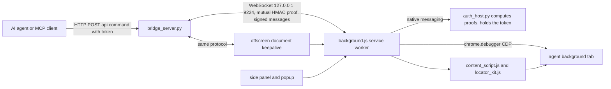

# antigravity-chrome-sidepanel

**Antigravity Browser Bridge 2.3.0**: a Chrome (Manifest V3) extension and a small local bridge server that let an AI
agent, such as Google Antigravity, drive the user's real Chrome **in a background tab**, with real (trusted) mouse
and keyboard events sent through the Chrome DevTools Protocol, while the user keeps working in their own tabs.

Chrome 116+ (125+ for out-of-process iframes) · Python 3.10+ for the bridge · MIT licence

## Why

Browser automation usually means a separate headless browser (no sessions, no extensions) or screen-level computer
use that moves the user's cursor and brings the window to the front. This extension works inside the browser the user
already uses: the agent gets its own background tab, grouped under an "Antigravity" tab group, and acts there through
`chrome.debugger` without activating the tab or the window. Clicks and typing are real input events
(`isTrusted: true`) aimed at a point that was checked to hit the target, and every action reports how it was done.

## What it does

### Strict locators

Every targeting command accepts a `locator`, modelled on Playwright's `getByRole` / `getByLabel` / `getByText` /
`getByPlaceholder` / `getByTestId`:

```json
{"role": "button", "name": "Submit"}
{"label": "Email"}
{"text": "Continue", "exact": true}
{"placeholder": "Search"}
{"testId": "submit"}
```

Also `altText`, `title`, `hasText`, `nth` (negative counts from the end), `includeHidden`, and state filters
(`checked`, `disabled`, `expanded`, `pressed`, `selected`, `level`). Matching is strict: several matches without
`nth` is an error that lists the candidates. `find` lists candidates (role, name, frame, visibility, state, box)
without acting. In the main frame Chrome's accessibility tree (`Accessibility.queryAXTree`) is used, completed by a
DOM engine (`locator_kit.js`) shared with the page scripts. CSS selectors and Set-of-Marks numbers (`mark`) are still
accepted.

### Real clicks and typing through CDP

- `click`, `hover`, `drag_and_drop`, `click_mark`, `semantic_click` send `Input.dispatchMouseEvent` to the agent tab
  without bringing it forward (left, right, middle, double click). The target is scrolled to the centre and the
  clicked point must reach it (`elementFromPoint` through shadow roots and frames); a covered element is reported as
  an error instead of clicking something else. Page focus emulation is enabled before mouse input so background tabs
  receive the press and release.
- `fill` (replace), `type` (append), `semantic_fill` and targeted `type_keys` focus the field with a real click,
  select with a real Ctrl+A, type with `Input.insertText` (or key by key) and read the value back (`verified`). This
  works on `contenteditable` editors. The old native-setter path remains as a reported fallback.
- `press_key` accepts shortcuts (`Control+A`, `Shift+Tab`); `check` / `uncheck` click only when the state differs and
  read it back.
- Responses carry `method` (`cdp`, or `js_fallback` when the debugger cannot attach), and `trusted_click`,
  `trusted_hover`, `trusted_drop` from a probe that records whether a trusted event actually reached the element.

### Cross-origin and out-of-process iframes

Out-of-process iframes are reached through flat child sessions (`Target.setAutoAttach` with `flatten`, commands
addressed by `sessionId`, Chrome 125+); same-process cross-origin frames through an isolated world. Points are mapped
back to the main viewport through each owning `<iframe>`, and real input goes to the main page. `content`,
`interactive_map` and `find` report the frame.

### Network and downloads

`network_requests` keeps a ring buffer of 500 requests per tab (main session and iframes), filterable by URL fragment
or regex, method, status, type. `Cookie`, `Set-Cookie`, `Authorization`, `Proxy-Authorization`, `X-Api-Key`,
`X-Auth-Token`, `X-CSRF-Token` and `X-XSRF-Token` headers are always masked. `network_response` returns a body
(truncated, binary flagged). `wait_download` waits for a download started from the agent's tab and returns its path.

### Dialogs

JavaScript dialogs (`alert`, `confirm`, `prompt`) are never accepted automatically. The open dialog is
reported in the response of the command that opened it (`dialogOpened`) and of every following command
(`pendingDialogs`); commands that need the blocked page are refused until `handle_dialog` accepts or dismisses it.

### Background tab and tab groups

The agent works in its own tab (`create_tab` opens it in the background), remembered in `chrome.storage.session` so it
survives a service worker restart. `close_tab`, `navigate` and `reload` without a tab id or a known agent tab are
refused instead of targeting the user's active tab. No mouse command calls `tabs.update({active: true})` or
`windows.update({focused: true})`. Agent tabs are grouped under a purple "Antigravity" tab group, and a small,
click-through status pill shows the current action. The debugger is detached after 30 s of inactivity.

### Other commands

Tabs (`list_tabs`, `get_active_tab`, `select_tab`, `create_tab`, `close_tab`, `group_tabs`, `navigate`, `reload`),
reading (`get_dom`, `get_accessibility_tree`, `interactive_map` with Set-of-Marks badges, `vision_inspect`,
`get_logs`, `screenshot`, `print_pdf`, `get_cookies`), waiting (`wait_load`, `wait_network_idle`), `scroll`,
`select_option`, `upload_file`, `evaluate`, `cdp_send`, `ping` (version and loaded feature list).

### Side panel

`Ctrl+Shift+A` opens a side panel. It shows the real state of both bridge connections and the targeted tab, and every
control does what it says:

- **Map clickable elements**: only clickable elements; each number is a real click.
- **Inspect form fields**: label, type, required, filled or empty; never the value typed.
- **Session cookies**: count, domains and names only; cookie values never leave the service worker.
- **Capture**: an image of the targeted tab.

The panel has no language model of its own. Text typed in it is **sent to the agent through the authenticated bridge**
(`sidepanel_requests` to read pending requests, `sidepanel_reply` to answer in the panel's thread); without an
authenticated bridge nothing is sent and the panel says so. The queue lives in the bridge's memory (50 requests).

## Architecture



```
extension/
  manifest.json       MV3 manifest: debugger, tabs, tabGroups, scripting, downloads, offscreen, sidePanel, storage, nativeMessaging
  background.js       service worker: command dispatch, CDP input, locators, frames, network log, dialogs, downloads
  locator_kit.js      role/label/text locator engine shared with page scripts
  content_script.js   page side: status pill, Set-of-Marks badges
  offscreen.html/.js  keeps the WebSocket to the bridge alive
  sidepanel.*         side panel UI
  popup.*             toolbar popup (status)
native-host/
  bridge_server.py    local server: WebSocket 127.0.0.1:9224 (extension), HTTP 127.0.0.1:9225 (agent)
  bridge_security.py  per-user token (created on first start, restricted file permissions)
  bridge_config.json  explicit list of extension origins allowed on the WebSocket
  bridge_auth.py      protocol nexusagy-bridge/1: challenge-response proofs and per-connection message signing
  auth_host.py        native messaging host: computes the extension's proofs, so the token never reaches Chrome
  install-native-host.ps1  registers the native host for the current user (HKCU)
tests/
  browser.test.cjs    94 Node tests against simulated Chrome APIs, CDP input and DOM (no browser needed)
```

The bridge HTTP API:

- `GET /api/status` returns `{status, version, connected_clients, port}`.
- `POST /api/command` with `Content-Type: application/json` and body `{"action", "params", "timeout"}` (timeout 0.1 to
  120 s) returns `{"success", "data"}` or `{"success": false, "error"}`.
- Every request needs the header `X-NexusAGY-Token` with the content of the token file. Requests carrying an `Origin`
  header (that is, coming from a web page) are refused. Headers are limited to 64 KB and bodies to 16 MB.

## Installation

1. **Bridge**: install Python 3.10+ and `websockets` (12 to 16), then start the server.

   ```powershell
   git clone https://github.com/pironjulien/antigravity-chrome-sidepanel.git
   cd antigravity-chrome-sidepanel
   python -m pip install "websockets>=12,<17"
   python native-host/bridge_server.py            # optional: --token-file <path> --log-file <path>
   ```

   The token is created on first start in `%USERPROFILE%\.nexusagy\bridge-token` (override with `--token-file`).

2. **Extension**: open `chrome://extensions`, enable Developer mode, choose *Load unpacked* and select the
   `extension` folder. Copy the extension ID shown by Chrome.

3. **Allow the extension**: add `chrome-extension://<your extension ID>/` to `allowed_origins` in
   `native-host/bridge_config.json` and restart the bridge. An unpacked extension's ID depends on its folder, so the IDs
   already listed will not match yours.

4. **Register the native host** that computes the extension's authentication proofs, then reload the extension in
   `chrome://extensions` (a manifest change, such as the `nativeMessaging` permission, is only picked up by a reload
   there):

   ```powershell
   pwsh -NoProfile -File native-host\install-native-host.ps1      # -Python <path> if python.exe is not on PATH
   ```

5. **Agent side**: call the HTTP API from your agent or wrap it in MCP tools. Example from PowerShell:

   ```powershell
   $token = Get-Content "$env:USERPROFILE\.nexusagy\bridge-token" -Raw
   $body = @{ action = 'create_tab'; params = @{ url = 'https://example.com'; background = $true } } | ConvertTo-Json
   Invoke-RestMethod http://127.0.0.1:9225/api/command -Method Post -ContentType 'application/json' `
     -Headers @{ 'X-NexusAGY-Token' = $token.Trim() } -Body $body
   ```

   The MCP client used with Antigravity (40 browser tools) is part of a private configuration and is not included here.

## Usage examples

```json
{"action": "click", "params": {"locator": {"role": "button", "name": "Sign in"}}}
{"action": "fill",  "params": {"locator": {"label": "Email"}, "text": "ada@example.com"}}
{"action": "find",  "params": {"locator": {"role": "link", "hasText": "Docs"}}}
{"action": "network_requests", "params": {"filter": "/api/", "failed_only": true}}
{"action": "handle_dialog", "params": {"accept": false}}
```

## Measurements

From the project's changelog (October 15, 2026), measured in the author's real Chrome with an agent tab in the
background:

- Real-browser validation `--mouse`: 11/11 checks (trusted-only button, double and right click, CSS `:hover` menu,
  covered element reported, drag and drop counted once, same-origin iframe button, `confirm()`), two runs in a row,
  the user's active tab unchanged and their tabs intact.
- Real-browser validation `--full-live`: 27/27 checks (duplicate button names with `nth`, `testId`, label and
  placeholder fields, a field that rejects untrusted input, `contenteditable`, check box, `<select>`, an out-of-process
  and a same-process cross-origin iframe, masked `Authorization` header with body read back, a download), two runs in
  a row.
- Version 2.3.0 (October 16, 2026), same real Chrome: `--mouse` 11/11 and `--full-live` 26/26 with the authenticated
  bridge, the out-of-process iframe click passing 6 runs out of 6 (a first click whose probe proves that no event at
  all reached the element is resent once).
- Offline: 94/94 Node tests (`test.ps1`, October 16, 2026).

The two real-browser validation scripts are not part of this repository (they depend on the private agent client).

## Security

- The bridge listens on 127.0.0.1 only. The agent-facing HTTP API requires the per-user token and refuses any request
  with an `Origin` header, so web pages cannot call it.
- The WebSocket is **authenticated in both directions** (protocol `nexusagy-bridge/1`, version 2.3.0). The extension
  sends a nonce; the bridge answers with its own nonce and an HMAC-SHA256 proof of the token over both nonces, the role
  and the extension ID; only if that proof is right does the extension prove the token in turn. The token is never
  sent, and two fresh nonces per connection make a recorded proof useless. A derived session key then signs every
  message both ways with a strict sequence number: an unsigned, badly signed, replayed or out-of-order message closes
  the connection without being executed, and nothing runs before the bridge's signed `auth_ok`. A program that forges
  the `Origin` header or listens on 9224 in the bridge's place gets no command executed.
- The extension never holds the token: a native messaging host (`auth_host.py`, allowed only for the extension IDs in
  `bridge_config.json`) reads it and computes the proofs. Ports 9224 and 9225 are bound exclusively.
- Sensitive network headers are masked in the network log.
- JavaScript dialogs are never accepted automatically. Mouse commands never activate the tab or the window.
- The extension requests broad permissions (`debugger` and `<all_urls>`, with commands such as
  `get_cookies`, `evaluate` and `cdp_send`): whoever holds the bridge token controls the browser session. Keep the token private.

## Working alongside other agents

On the author's PC this bridge is one of three desktop agents (with
[claude-windows-computer-use](https://github.com/pironjulien/claude-windows-computer-use) and
[codex-windows-computer-use](https://github.com/pironjulien/codex-windows-computer-use)). They share a foreground token
(`%USERPROFILE%\.nexus\foreground.lock`, exclusive `LockFileEx` on 1 byte at offset 2^32, released by Windows when the
handle closes) and an emergency stop (Ctrl+Alt+Shift+Esc writes `%USERPROFILE%\.nexus\stop`; a new version younger
than 120 s blocks every action for the remaining time, latched in memory). Background CDP input needs neither the
mouse nor the foreground, so it never takes the token. **In this repository, both protocols are enforced by the
agent-side client, which is not included**: the extension and the bridge do not read the stop file. An agent built on
this bridge should check `%USERPROFILE%\.nexus\stop` before each action.

## Limits

- Chrome only (Manifest V3, `chrome.debugger`). While the debugger is attached, Chrome shows its "is being debugged"
  banner on the agent tab. Protected pages (`chrome://`, the Web Store) cannot be scripted.
- The accessibility-tree engine covers the main frame only; frames use the DOM engine.
- When the debugger cannot attach (another debugger, protected tab), clicks fall back to JavaScript events, reported
  as `js_fallback` with `trusted_click: false`; many sites ignore those.
- Reloading the extension can keep the old service worker for a while; `ping` reports the loaded feature list so an
  agent can detect it.
- UI strings and code comments are partly in French.

## Development

```powershell
pwsh -NoProfile -File test.ps1   # Node tests of the extension and a syntax check of the bridge
```

## Licence

MIT, see [LICENSE](LICENSE). Copyright (c) 2026 Julien Piron.
