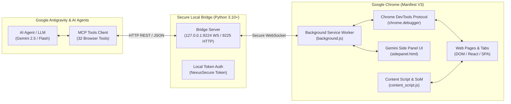

# Antigravity Chrome — Autonomous Browser Use & Web Automation Bridge 🌐🤖✨

[](https://developer.chrome.com/docs/extensions/mv3/intro/)
[](https://modelcontextprotocol.io/)
[](https://gemini.google.com)
[](https://python.org)
[](LICENSE)
[](https://julienpiron.fr)

> **Autonomous Browser Use, form filling, and Chromium web automation bridge engineered for Google Antigravity and AI agents. Equipped with real-time Chrome DevTools Protocol (CDP), Set-of-Marks visual grounding, and a 1:1 Google Gemini copilot Side Panel.**

Engineered natively for **Google Antigravity** and sovereign agentic orchestration loops, **Antigravity Chrome** equips your AI agents with real eyes and hands to interact with the modern Web in a 100% autonomous, deterministic, and silent fashion.

---

## ⚡ SOTA Architecture & Technical Advantages

| Dimension | Conventional Approach (Web Scripts) | Antigravity Chrome (This Project) |
| :--- | :--- | :--- |
| **Form Filling** | Blind typing approximation | **Deterministic input (`fill`, `type_keys`) with DOM state verification & native React/Vue events** |
| **Visual Grounding** | Coarse pixel guessing | **Accessibility tree (`axtree`) + Set-of-Marks (SoM) with dynamic `[#1]`, `[#2]` badges** |
| **Underlying Protocol** | Full OS screen capture | **Direct Chrome DevTools Protocol (CDP) via secure local WebSocket (`127.0.0.1:9224`)** |
| **Multi-Tab Management** | Limited or non-existent | **Full control: `list_tabs`, `select_tab`, `new_tab`, `close_tab`, quick `@` tab picker** |
| **Concurrent Background Isolation** | Steals focus or blocks user | **100% background execution (`active: false`) without focus theft + dedicated Chrome "Antigravity" Tab Groups** |
| **Data Extraction** | Basic text scraping | **Structured DOM tree dumps, real-time console logs, session cookies, and vector PDF export** |
| **Interface & Ergonomics** | Headless black box | **Persistent MV3 Side Panel styled after Google Gemini (`#131314`), voice dictation, and Auto mode** |

---

## 🚀 Key Automation Capabilities

### 1. 📝 Autonomous Form Filling & Data Entry
- Automated multi-field form filling (text inputs, passwords, textareas, dropdown `<select>` menus, checkboxes, radio buttons).
- Native dispatch of synthetic JavaScript events (`input`, `change`, `blur`) required by modern Single Page Applications (React, Next.js, Vue, Angular).
- Multi-step wizards and form workflows with validation error detection and self-correcting loops.

### 2. 🎯 Deterministic Clicking & Web Navigation
- Precision Playwright-grade clicks by CSS selector, XPath, or screen coordinates with visual laser ripple (`__antigravity_visual_click`).
- Semantic click support based on visible text and ARIA roles.
- Intelligent scrolling (`scroll`) and hovering (`hover`) to expose dropdown menus and tooltips.
- Seamless multi-tab navigation (`navigate`, `reload`, `select_tab`, `new_tab`, `close_tab`).

### 3. 🏷️ Set-of-Marks (SoM) & Vision AI Grounding
- Instant numerical badge injection (`[#1]`, `[#2]`, ...) on all interactive elements across the active page (including recursive Shadow DOM).
- Enables multimodal models (Gemini 2.5 Pro / Flash) to target elements with pinpoint accuracy, eliminating selector fragility.

### 4. 🔍 Data Extraction & Web Inspection
- **Accessibility Tree (`axtree`)**: Compact semantic hierarchy extraction for rapid spatial and logical understanding.
- **Live Console Logs**: Real-time capture of `console.log`, `console.error`, and warnings for web diagnostics.
- **Screenshots & PDF**: Compressed WebP/PNG dumps (< 200 KB) and vector PDF rendering via CDP.
- **Cookies & Sessions**: Read and inject session cookies for persistent authenticated browsing without repeated login prompts.

### 5. 💬 1:1 Google Gemini Copilot Side Panel
- Persistent Chrome docking interface (`sidepanel.html`), accessible at any time via **`Ctrl + Shift + A`**.
- Native Google Gemini dark aesthetic (`#131314`), Google Sans fluid typography, and animated sparkle indicator.
- **Dynamic Context Chip ("Work with Tabs")**: Auto-detects active tab with `@` shortcut and `+` action button.
- **Native Voice Input**: Web Speech API interactive microphone with real-time audio pulse and transcription.
- **`AGY 2.0 • Auto` Mode**: Automatically routes user prompts between direct model inference, deep Pro reasoning, or Flash speed.

### 6. 🛡️ Concurrent Background Isolation & "Antigravity" Tab Groups
- **Zero Interruption (Parallel Independent Work)**: Antigravity opens working tabs in the background by default (`active: false`). Users continue browsing, typing, and working without cursor interruption or focus theft.
- **Persistent Agent Targeting (`lastAgentTabId`)**: All agent commands execute deterministically on background tabs without touching the user's active foreground tab.
- **Native Chrome Tab Groups (`chrome.tabGroups`)**: Tabs created by the agent are automatically grouped into a dedicated purple Chrome group named **"Antigravity"**, isolated from personal tabs and collapsible in a single click.
- **Non-Intrusive Status Pill**: Subtle translucent `⚡ Antigravity · [Action]` pill in the bottom-right corner of driven tabs, click-transparent (`pointer-events: none`) with 0 ms latency and zero CPU footprint.

---

## 🏛️ Technical Architecture



---

## 🛠️ Agent Tools Directory (MCP / API)

The Antigravity agent has access to 32 dedicated tools to automate Chrome:

| Tool | Description |
| :--- | :--- |
| `browser_new_tab(url, background=True, group="Antigravity")` | Opens a tab in the background without stealing focus and assigns it to the Antigravity group. |
| `browser_group_tabs(tab_ids, title, color)` | Groups tabs into a named, colored Chrome tab group (`chrome.tabGroups`). |
| `browser_interactive_map(viewport_only=True)` | Compact interactive element map with SoM `[#N]` marks (saves 85% to 95% tokens). |
| `browser_navigate(url)` | Navigates target tab to specified URL. |
| `browser_click(selector, mark)` | Executes precision Playwright-grade click with visual ripple on selector or SoM mark `[#N]`. |
| `browser_fill(selector, text, mark)` | Deterministic form input (React, Next.js, contenteditable). |
| `browser_hover(selector, mark)` | Hovers over an element to reveal dropdown menus and tooltips. |
| `browser_press_key(key)` | Dispatches native key events (`Enter`, `Tab`, `ArrowDown`, etc.). |
| `browser_select_option(selector, value)` | Selects an option in `<select>` dropdown menus. |
| `browser_drag_and_drop(from_mark, to_mark)` | Multi-step drag and drop action via CDP. |
| `browser_wait_load()` | Waits for complete DOM document stabilization. |
| `browser_wait_network_idle()` | Waits for active Fetch/XHR network requests to complete. |
| `browser_upload(files, selector)` | Direct file upload bypassing OS file picker dialogs. |
| `browser_scroll(direction, y)` | Scrolls target page (`up`, `down`, pixels). |
| `browser_screenshot(format, mark)` | Captures tab or element screenshot in compact WebP/PNG (< 200 KB). |
| `browser_content()` | Extracts clean DOM or text from active page. |
| `browser_axtree()` | Retrieves semantic accessibility tree for agent reasoning. |
| `browser_list_tabs()` | Lists all open tabs with IDs, URLs, titles, and `groupId`. |
| `browser_active_tab()` | Returns active tab metadata. |
| `browser_select_tab(tab_id)` | Switches focus and foreground to specified tab. |
| `browser_close_tab(tab_id)` | Closes specified tab or background agent tab. |
| `browser_reload(bypass_cache)` | Reloads tab content with optional cache bypass. |
| `browser_eval(script)` | Evaluates arbitrary JavaScript within the page context. |
| `browser_get_cookies(urls)` | Retrieves session cookies for authentication persistence. |
| `browser_check_handoff()` | Proactively detects 2FA, OTP, or CAPTCHA verification challenges. |
| `browser_cdp_send(method, params)` | Sends raw Chrome DevTools Protocol commands directly. |
| `browser_logs()` | Fetches browser console logs. |

---

## 🚀 Quickstart & Setup

### 1. Clone the Repository
```bash
git clone https://github.com/pironjulien/antigravity-chrome-sidepanel.git
cd antigravity-chrome-sidepanel
```

### 2. Load the Extension in Google Chrome
1. Open Google Chrome and navigate to `chrome://extensions`.
2. Enable **Developer mode** (toggle in top-right corner).
3. Click **Load unpacked**.
4. Select the `extension/` directory from this repository.

### 3. Start the Local Bridge Server
```bash
python native-host/bridge_server.py
```
> The server listens on `ws://127.0.0.1:9224` (WebSocket) and `http://127.0.0.1:9225` (REST API). It is immediately ready to accept agent requests.

### 4. Everyday Usage
- **Side Panel Shortcut**: Press **`Ctrl + Shift + A`** to toggle the panel anytime.
- **`@` Tab Picker**: Type `@` in the text box to target any open browser tab.
- **Voice Dictation**: Click the microphone icon and speak natural-language instructions.
- **Autonomous Agents**: Trigger agent workflows from Antigravity; Chrome is driven autonomously in the background!

---

## ⌨️ Shortcuts Reference

| Shortcut | Action |
| :--- | :--- |
| `Ctrl + Shift + A` | Open / close the Chrome Side Panel |
| `@` | Open tab context selector |
| `Enter` | Submit prompt to copilot |
| `click #N` | Direct click on Set-of-Marks badge `#N` |

---

## 👨‍💻 Author & License

Engineered by **Julien Piron** ([julienpiron.fr](https://julienpiron.fr) • [julienpiron.com](https://julienpiron.com) • X: [@julienpironfr](https://x.com/julienpironfr)).  
Released under the **MIT License**. See [LICENSE](LICENSE) for details.
